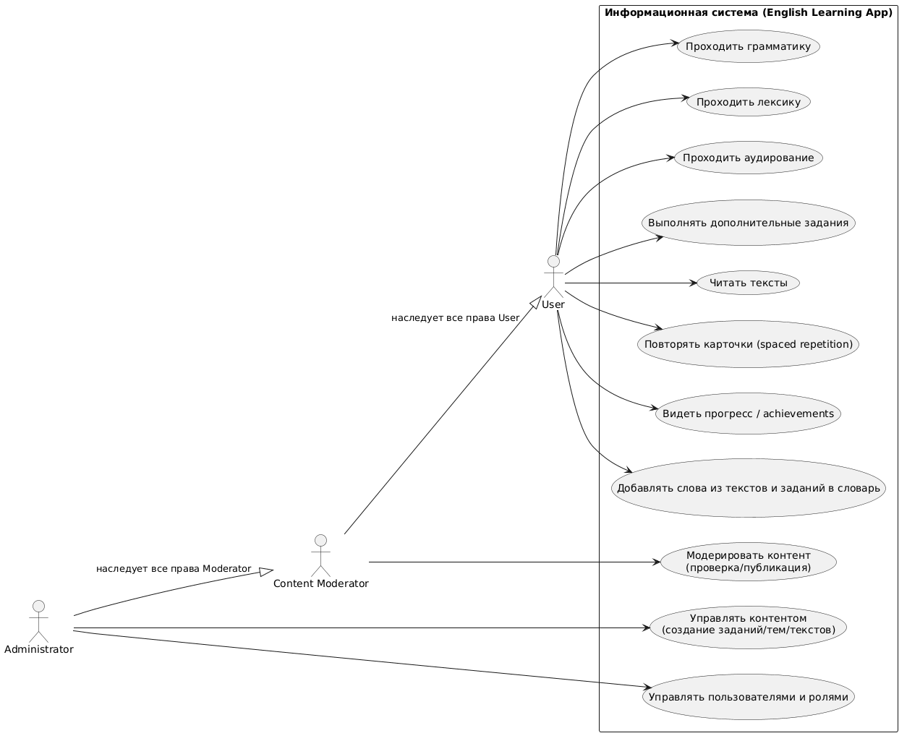
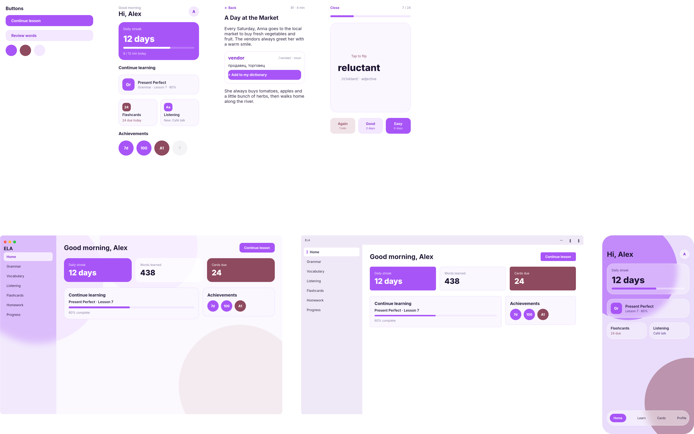
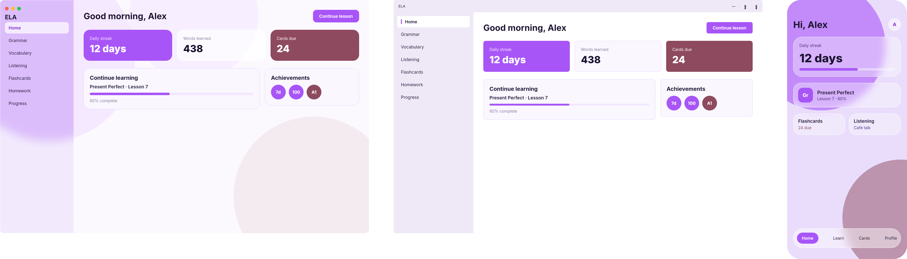
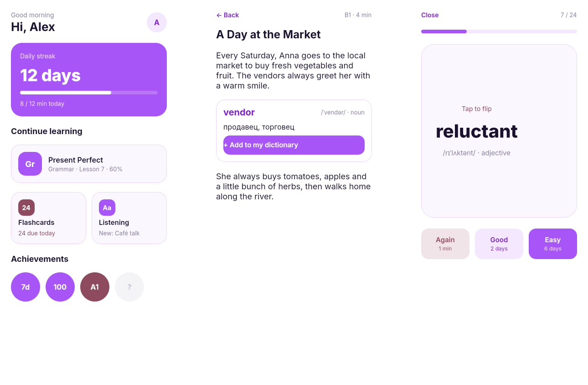
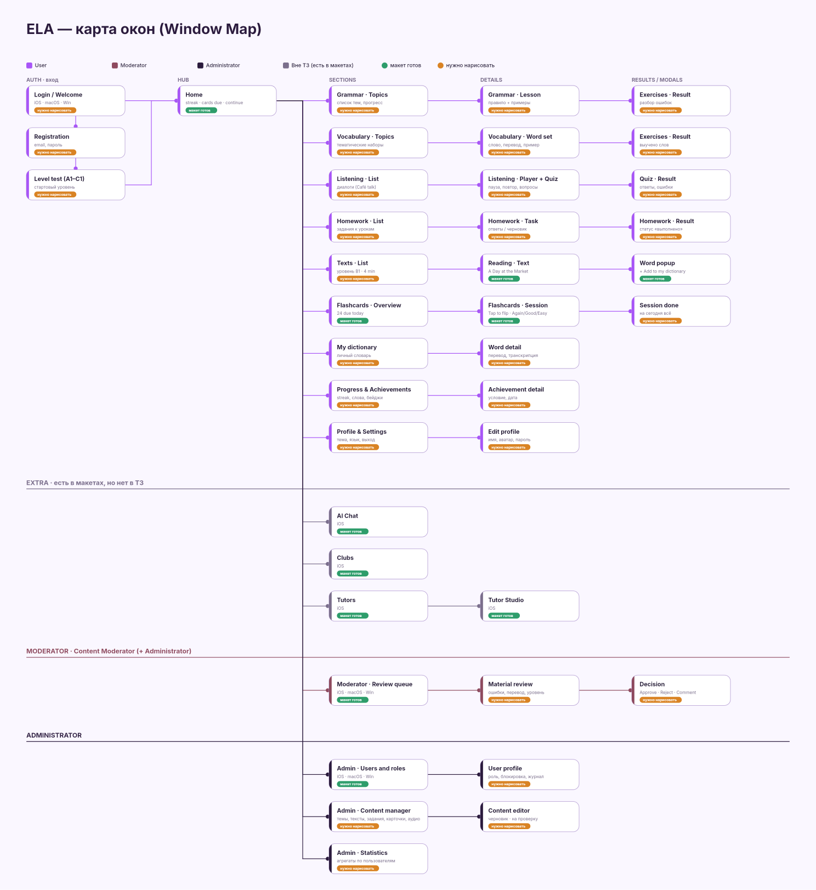

# ELA — English Learning App

## 1. Проблема

Информационная система решает проблему низкого уровня знаний английского языка: она содержит все основные направления изучения языка в одном приложении и поддерживает мотивацию через учёт прогресса и достижений.

## 2. Цель системы

Информационная система решает проблему низкого уровня знаний английского языка. Она может помочь пользователям изучать английский с нуля или повышать уровень:рамматика (grammar), лексика (vocabulary), аудирование (listening), домашние задания, интерактивный словарь из читаемых текстов, интервальные повторения слов по карточкам (spaced repetition).

## 3. Описание приложения

- **Клиентская часть** — приложение для macOS, Windows и мобильных устройств с единым дизайном, через него пользователь учится, с возможностью в дальнейшем, загрузить темы и задания. 
- **Серверная часть** — хранит контент (темы, задания, тексты, наборы карточек), аккаунты, роли, словари пользователей и прогресс. Через неё работают модерация и администрирование.

### Словарь предметной области

- **Grammar** — уроки по темам (например, Present Perfect) с отслеживанием прохождения.
- **Vocabulary** — изучение лексики по темам.
- **Listening** — аудирование на основе коротких диалогов и ситуаций (например, Cafe talk).
- **Homework** — домашние задания по пройденным урокам.
- **Чтение текстов с интерактивным словарём** — нажатие на слово показывает перевод, транскрипцию и часть речи; слово можно добавить в личный словарь.
- **Flashcards** — интервальные повторения слов (spaced repetition). Пользователь оценивает ответ, и система сама определяет, когда показать карточку снова.
- **Progress и achievements** — серия дней занятий (streak), количество выученных слов, награды за достижения.

## 4. Роли

### Диаграмма ролей и вариантов использования

### Описание прецедентов

Во всех прецедентах пользователь предварительно авторизован. Прецеденты UC1–UC8 доступны всем ролям, так как Moderator и Administrator наследуют права User.

#### UC1. Проходить грамматику

- **Актор:** User.
- **Цель:** изучить грамматическую тему и закрепить её упражнениями.
- **Предусловия:** в системе есть опубликованные уроки.
- **Основной сценарий:**
  1. Пользователь открывает раздел Grammar и выбирает тему (например, Present Perfect).
  2. Система показывает урок: объяснение правила с примерами.
  3. Пользователь выполняет упражнения.
  4. Система проверяет ответы, показывает результат и разбор ошибок.
  5. Система сохраняет прогресс по уроку.
- **Альтернативный сценарий:** пользователь прерывает урок, система запоминает место, и занятие можно продолжить кнопкой «Continue lesson».
- **Постусловие:** обновлены прогресс по теме и время занятий за день (streak).

#### UC2. Проходить лексику

- **Актор:** User.
- **Цель:** расширить словарный запас по темам.
- **Предусловия:** есть опубликованные тематические наборы слов.
- **Основной сценарий:**
  1. Пользователь открывает раздел Vocabulary и выбирает тему.
  2. Система показывает слова с переводом, транскрипцией и примерами.
  3. Пользователь выполняет упражнения на закрепление.
  4. Система оценивает результат и сохраняет прогресс.
- **Альтернативный сценарий:** пользователь добавляет незнакомое слово в личный словарь (см. UC8).
- **Постусловие:** обновлена статистика выученных слов.

#### UC3. Проходить аудирование

- **Актор:** User.
- **Цель:** научиться понимать английскую речь на слух.
- **Предусловия:** есть опубликованные аудиоматериалы (например, Café talk).
- **Основной сценарий:**
  1. Пользователь открывает раздел Listening и выбирает аудио.
  2. Система воспроизводит запись; пользователь может ставить на паузу и повторять фрагменты.
  3. Пользователь отвечает на вопросы к записи.
  4. Система проверяет ответы и показывает результат.
- **Альтернативный сценарий:** аудио не загрузилось, система показывает сообщение об ошибке и предлагает повторить попытку.
- **Постусловие:** сохранён результат и обновлён прогресс.

#### UC4. Выполнять дополнительные задания

- **Актор:** User.
- **Цель:** закрепить пройденный материал на практике (Homework).
- **Предусловия:** для пройденных тем есть задания.
- **Основной сценарий:**
  1. Пользователь открывает раздел Homework и выбирает задание.
  2. Пользователь выполняет задание и отправляет ответы.
  3. Система автоматически проверяет их и показывает результат с разбором ошибок.
  4. Система отмечает задание как выполненное.
- **Альтернативный сценарий:** задание не завершено, система сохраняет черновик ответов.
- **Постусловие:** статус задания и общий прогресс обновлены.

#### UC5. Читать тексты

- **Актор:** User.
- **Цель:** практиковать чтение и пополнять словарный запас в контексте.
- **Предусловия:** есть опубликованные тексты с указанием уровня и времени чтения (например, «B1 · 4 min»).
- **Основной сценарий:**
  1. Пользователь выбирает текст из списка.
  2. Система показывает текст на английском.
  3. Пользователь читает текст; при нажатии на незнакомое слово система показывает карточку слова: перевод, транскрипцию, часть речи.
  4. Пользователь завершает чтение, система отмечает текст как прочитанный.
- **Постусловие:** текст отмечен в истории, обновлена статистика занятий.
- **Связанный прецедент:** UC8 (добавление слова в словарь).

#### UC6. Повторять карточки (spaced repetition)

- **Актор:** User.
- **Цель:** запомнить слова надолго с помощью интервальных повторений.
- **Предусловия:** в личном словаре есть карточки, срок повторения которых наступил (например, 24 карточки).
- **Основной сценарий:**
  1. Пользователь открывает раздел Flashcards.
  2. Система показывает слово на лицевой стороне карточки.
  3. Пользователь вспоминает перевод и переворачивает карточку (Tap to flip).
  4. Пользователь оценивает ответ: Again, Good или Easy.
  5. Система рассчитывает дату следующего показа по выбранной оценке (например, Again — через 1 минуту, Good — через 2 дня, Easy — через 6 дней) и показывает следующую карточку.
- **Альтернативные сценарии:** если карточек для повторения нет, система сообщает, что на сегодня всё выполнено; пользователь может закрыть сессию досрочно (Close), прогресс сохраняется.
- **Постусловие:** у каждой оценённой карточки обновлены интервал и дата следующего повторения.

#### UC7. Видеть прогресс и achievements

- **Актор:** User.
- **Цель:** отслеживать свои успехи и сохранять мотивацию.
- **Предусловия:** пользователь имеет хотя бы одно завершённое занятие (для нового пользователя показываются нулевые значения).
- **Основной сценарий:**
  1. Пользователь открывает главный экран или раздел Progress.
  2. Система показывает серию дней занятий (streak), количество выученных слов, число карточек к повторению, прогресс по текущим урокам.
  3. Система показывает полученные achievements и ещё не открытые (серые бейджи со знаком «?»).
- **Дополнительно:** система автоматически выдаёт achievement, когда выполнено условие (например, 7 дней подряд или 100 выученных слов).
- **Постусловие:** состояние не меняется (прецедент только на просмотр).

#### UC8. Добавлять слова из текстов и заданий в словарь

- **Актор:** User.
- **Цель:** собрать личный словарь из незнакомых слов.
- **Предусловия:** пользователь находится в тексте или задании с интерактивными словами.
- **Основной сценарий:**
  1. Пользователь нажимает на слово.
  2. Система показывает карточку слова: перевод, транскрипцию, часть речи.
  3. Пользователь нажимает «+ Add to my dictionary».
  4. Система сохраняет слово в личный словарь и создаёт для него карточку для повторений.
- **Альтернативный сценарий:** слово уже есть в словаре, система сообщает об этом и не создаёт дубликат.
- **Постусловие:** слово добавлено в словарь и попадёт в очередь повторений (UC6).

#### UC9. Модерировать контент (проверка и публикация)

- **Актор:** Content Moderator (Administrator наследует эту возможность).
- **Цель:** проверить качество материала перед публикацией.
- **Предусловия:** есть материалы (задания, темы, тексты) со статусом «На проверке».
- **Основной сценарий:**
  1. Модератор открывает очередь материалов на проверку.
  2. Модератор просматривает материал: ошибки, корректность перевода, уровень сложности.
  3. Модератор принимает решение: одобрить, отклонить или оставить комментарий с замечаниями.
  4. Система меняет статус материала и уведомляет автора.
- **Альтернативный сценарий:** при отклонении или замечаниях материал возвращается автору на доработку и после правок снова попадает в очередь.
- **Постусловие:** одобренный материал опубликован и доступен пользователям.

#### UC10. Управлять контентом (создание заданий, тем, текстов)

- **Актор:** Administrator.
- **Цель:** наполнять и поддерживать учебный контент платформы.
- **Предусловия:** у администратора есть доступ к панели управления.
- **Основной сценарий:**
  1. Администратор выбирает тип контента: задание, тема, текст, набор карточек, аудио.
  2. Администратор создаёт новый материал или редактирует существующий (заполняет содержимое, уровень, правильные ответы).
  3. Система проверяет обязательные поля.
  4. Администратор сохраняет материал, система отправляет его на проверку (UC9).
- **Альтернативные сценарии:** материал можно сохранить как черновик; устаревший материал можно архивировать, чтобы он не отображался пользователям.
- **Постусловие:** материал сохранён и ожидает модерации или опубликован.

#### UC11. Управлять пользователями и ролями

- **Актор:** Administrator.
- **Цель:** контролировать доступ к системе и распределять роли.
- **Предусловия:** у администратора есть доступ к панели управления.
- **Основной сценарий:**
  1. Администратор открывает список пользователей и находит нужного.
  2. Система показывает профиль: роль, дату регистрации, статус.
  3. Администратор изменяет роль (например, назначает пользователя модератором) или блокирует учётную запись.
  4. Система применяет изменения и записывает их в журнал действий.
- **Дополнительно:** администратор может просматривать агрегированную статистику по всем пользователям.
- **Постусловие:** права пользователя обновлены, они вступают в силу при следующем входе или обновлении сессии.

## 5. Описание интерфейса

### Общий стиль

Интерфейс светлый и спокойный. Основной цвет — фиолетовый, дополнительный акцентный — приглушённый бордовый. Фон светлый, с мягкими декоративными кругами. Карточки со скруглёнными углами и тонкой рамкой. Шрифт крупный и читаемый, заголовки жирные. Для всех платформ используются единые компоненты и цвета: основная кнопка — залитая фиолетовая («Continue lesson»), второстепенная — светло-сиреневая («Review words»).

**Общий макет интерфейса** (кнопки, мобильные экраны и главный экран на трёх платформах):

### Главный экран (Home)

Есть в трёх вариантах (macOS, Windows, мобильная версия):

### Мобильные экраны: главная, чтение текста, карточки

### Карта окон

