# ELA — English Learning App

## 1. Проблема

Людям, которые учат английский, сложно освоить язык системно. Типичные причины:

- **Знания разрознены.** Грамматика, лексика, аудирование и чтение изучаются в разных приложениях и книгах, поэтому нет цельной картины.
- **Слова быстро забываются.** Выученная лексика не повторяется вовремя, и результат не закрепляется.
- **Нет наглядного результата.** Человек не видит, сколько он уже выучил, и теряет мотивацию.
- **Нет контроля качества материалов.** Ошибки в заданиях и переводах портят обучение.

## 2. Цель системы

Создать единое приложение для изучения английского «с нуля» или для повышения уровня. Приложение должно:

- **Собрать все направления в одном месте:** грамматика (Grammar), лексика (Vocabulary), аудирование (Listening), домашние задания (Homework), чтение текстов (Reading).
- **Помогать запоминать слова:** нажатие на слово в тексте показывает перевод, слово добавляется в личный словарь, а карточки (Flashcards) повторяются по методу интервальных повторений (spaced repetition): система сама определяет, когда показать слово снова.
- **Поддерживать мотивацию:** показывает серию занятий (streak), число выученных слов и награды (achievements).
- **Гарантировать качество контента:** материалы создаёт администратор, а перед публикацией проверяет модератор.
- **Работать на macOS, Windows и мобильных устройствах** с единым дизайном.

## 3. Описание приложения

- **Клиентская часть** — приложение для macOS, Windows и мобильных устройств с единым дизайном, через него пользователь учится, с возможностью в дальнейшем, загрузить темы и задания. 
- **Серверная часть** — хранит контент (темы, задания, тексты, наборы карточек), аккаунты, роли, словари пользователей и прогресс. Через неё работают модерация и администрирование.

### Словарь предметной области

- **Grammar** — уроки по темам (например, Present Perfect) с отслеживанием прохождения.
- **Vocabulary** — изучение лексики по темам.
- **Listening** — аудирование на основе коротких диалогов и ситуаций (например, Cafe talk).
- **Homework** — домашние задания по пройденным урокам.
- **Чтение текстов с интерактивным словарём** — нажатие на слово показывает перевод, транскрипцию и часть речи; слово можно добавить в личный словарь.
- **Flashcards** — интервальные повторения слов (spaced repetition). Пользователь оценивает ответ, и система сама определяет, когда показать карточку снова.
- **Progress и achievements** — серия дней занятий (streak), количество выученных слов, награды за достижения.

## 4. Роли

### Диаграмма ролей и вариантов использования

### Описание прецедентов

Во всех прецедентах пользователь предварительно авторизован. Прецеденты для обычного пользователя (от «Проходить грамматику» до «Добавлять слова в словарь») доступны всем ролям, так как Moderator и Administrator наследуют права User.

Для каждого прецедента ниже приведено: что делает пользователь и система (сценарий), а также описание экрана приложения простым языком. Экраны показаны для трёх платформ (macOS, Windows, iOS) в светлой теме; на всех платформах набор элементов и логика работы одинаковы, отличается только компоновка под размер экрана.

#### Проходить грамматику

- **Актор:** User.
- **Цель:** изучить грамматическую тему и закрепить её упражнениями.
- **Предусловия:** в системе есть опубликованные уроки.
- **Основной сценарий:**
  1. Пользователь открывает раздел Grammar и выбирает тему (например, Present Perfect).
  2. Система показывает урок: объяснение правила с примерами.
  3. Пользователь выполняет упражнения.
  4. Система проверяет ответы, показывает результат и разбор ошибок.
  5. Система сохраняет прогресс по уроку.
- **Альтернативный сценарий:** пользователь прерывает урок, система запоминает место, и занятие можно продолжить кнопкой «Continue lesson».
- **Постусловие:** обновлены прогресс по теме и время занятий за день (streak).

**Как это выглядит на экране** — Grammar: урок и упражнение (macOS, Windows, iOS):

| macOS | Windows | iOS |
|:---:|:---:|:---:|
| 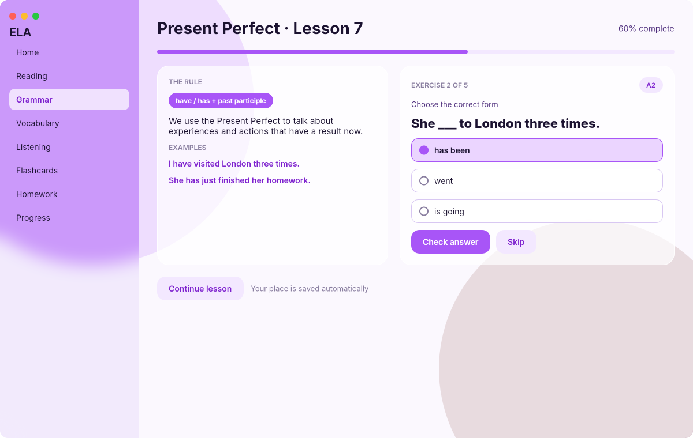 | 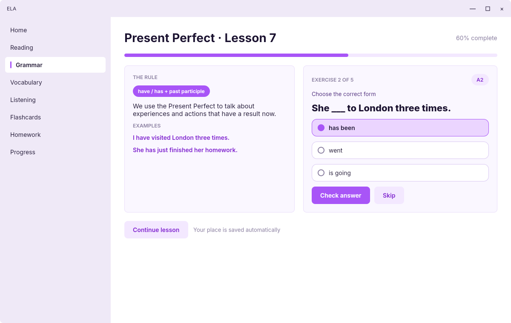 | 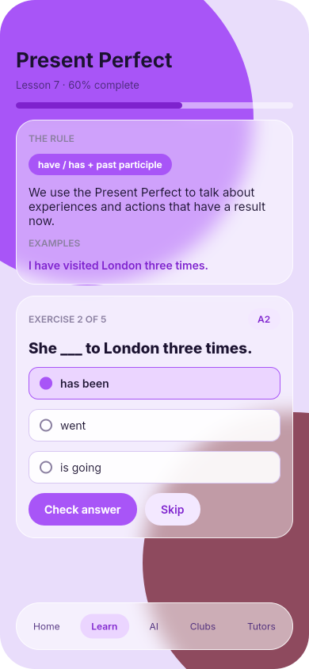 |

**Что видит и делает пользователь на этом экране:**

- **Слева — меню приложения** (Home, Reading, Grammar, Vocabulary, Listening, Flashcards, Homework, Progress). Текущий раздел Grammar подсвечен, поэтому пользователь всегда понимает, где находится.
- **Заголовок и полоса прогресса.** Вверху указано название урока («Present Perfect · Lesson 7») и «60% complete»; под ним — заполняющаяся полоса. Сразу видно, сколько пройдено и сколько осталось.
- **Левая карточка «The rule» — теория.** Краткая формула правила (have / has + past participle), объяснение простыми словами и два примера предложений.
- **Правая карточка — упражнение.** Подпись «Exercise 2 of 5» (задание 2 из 5), уровень сложности (A2), инструкция «Choose the correct form», предложение с пропуском («She ___ to London three times.») и три варианта ответа. Выбранный вариант подсвечивается.
- **Кнопки:** «Check answer» — проверить ответ; «Skip» — пропустить задание и вернуться к нему позже.
- **Внизу — «Continue lesson»** и подсказка «Your place is saved automatically»: пользователь может закрыть приложение в любой момент, ничего не потеряется.

#### Проходить лексику

- **Актор:** User.
- **Цель:** расширить словарный запас по темам.
- **Предусловия:** есть опубликованные тематические наборы слов.
- **Основной сценарий:**
  1. Пользователь открывает раздел Vocabulary и выбирает тему.
  2. Система показывает слова с переводом, транскрипцией и примерами.
  3. Пользователь выполняет упражнения на закрепление.
  4. Система оценивает результат и сохраняет прогресс.
- **Альтернативный сценарий:** пользователь добавляет незнакомое слово в личный словарь (см. «Добавлять слова из текстов и заданий в словарь»).
- **Постусловие:** обновлена статистика выученных слов.

**Как это выглядит на экране** — Vocabulary: слова темы (macOS, Windows, iOS):

| macOS | Windows | iOS |
|:---:|:---:|:---:|
| 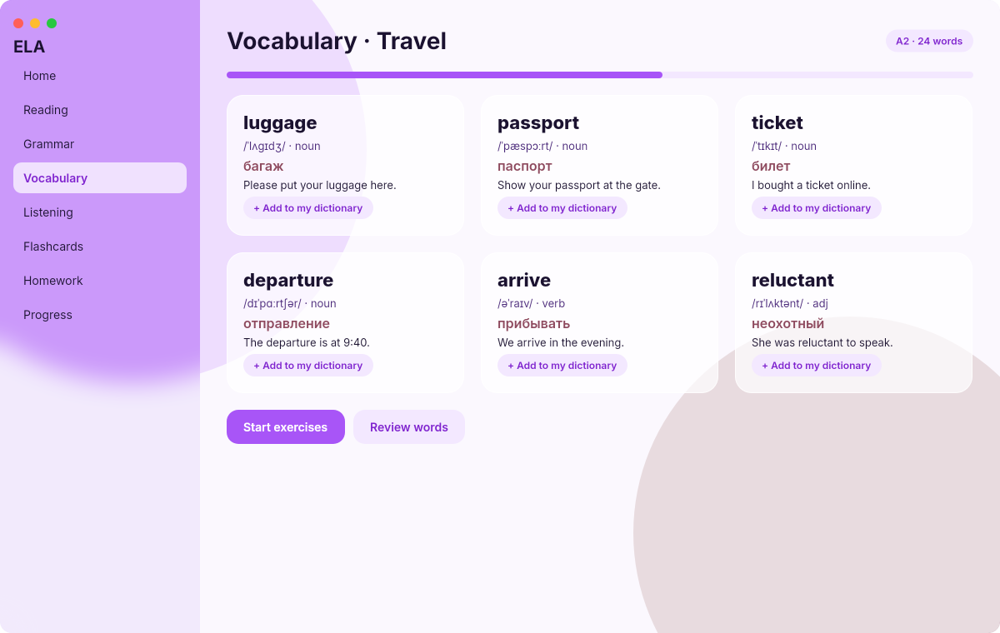 | 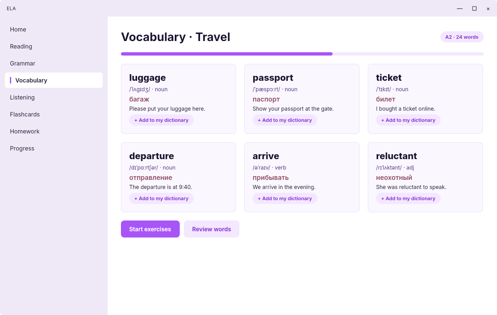 | 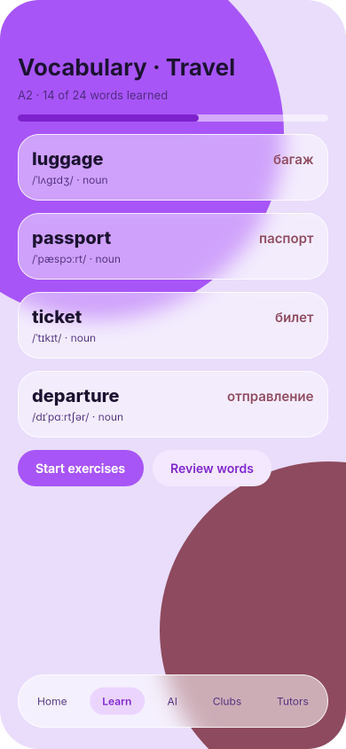 |

**Что видит и делает пользователь на этом экране:**

- **Заголовок темы** («Vocabulary · Travel»), справа метка с уровнем и размером набора («A2 · 24 words») и полоса прогресса по теме.
- **Сетка карточек слов.** Каждая карточка содержит: слово на английском, транскрипцию и часть речи (например, «/ˈlʌɡɪdʒ/ · noun»), перевод на русский (багаж), пример предложения («Please put your luggage here.»).
- **Кнопка «+ Add to my dictionary»** на каждой карточке — добавить слово в личный словарь одним нажатием.
- **Кнопки внизу:** «Start exercises» (основная) — перейти к упражнениям на закрепление; «Review words» — ещё раз просмотреть слова темы.

#### Проходить аудирование

- **Актор:** User.
- **Цель:** научиться понимать английскую речь на слух.
- **Предусловия:** есть опубликованные аудиоматериалы (например, Café talk).
- **Основной сценарий:**
  1. Пользователь открывает раздел Listening и выбирает аудио.
  2. Система воспроизводит запись; пользователь может ставить на паузу и повторять фрагменты.
  3. Пользователь отвечает на вопросы к записи.
  4. Система проверяет ответы и показывает результат.
- **Альтернативный сценарий:** аудио не загрузилось, система показывает сообщение об ошибке и предлагает повторить попытку.
- **Постусловие:** сохранён результат и обновлён прогресс.

**Как это выглядит на экране** — Listening: плеер и вопросы (macOS, Windows, iOS):

| macOS | Windows | iOS |
|:---:|:---:|:---:|
| 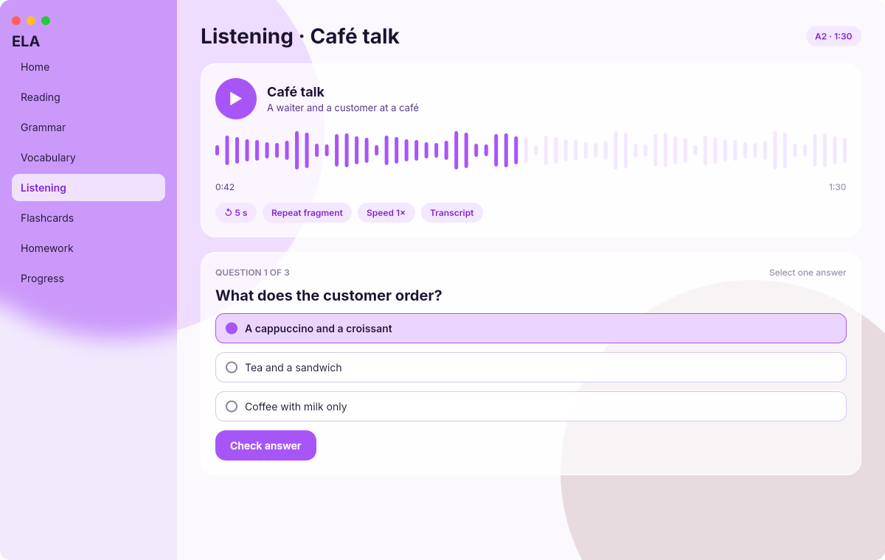 | 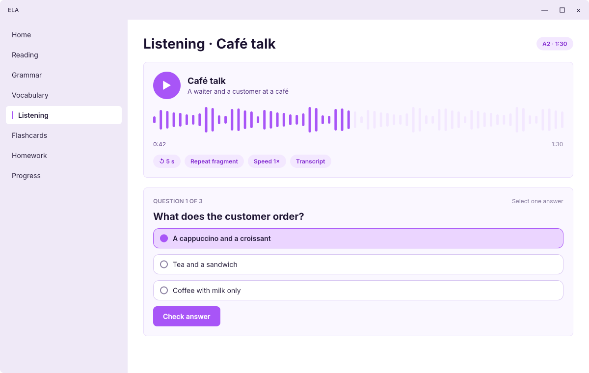 | 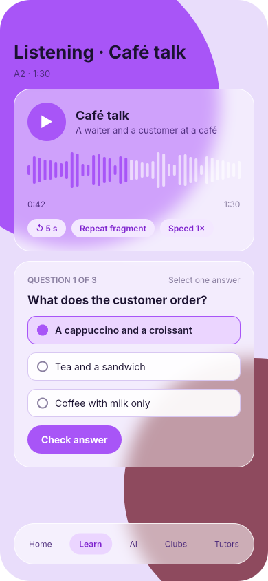 |

**Что видит и делает пользователь на этом экране:**

- **Заголовок** («Listening · Café talk») и метка «A2 · 1:30» — уровень и длительность записи.
- **Плеер.** Большая кнопка Play, название и краткое описание ситуации («A waiter and a customer at a café»), волна звука, по которой видно, какая часть уже прослушана, и время (0:42 из 1:30).
- **Кнопки управления:** «↻ 5 s» — перемотать на 5 секунд назад; «Repeat fragment» — повторить фрагмент; «Speed 1×» — изменить скорость; «Transcript» — показать текст записи (для проверки себя).
- **Блок вопросов.** «Question 1 of 3», вопрос («What does the customer order?») и три варианта ответа (выбирается один).
- **«Check answer»** — проверить ответ. После всех вопросов система показывает итог.

#### Выполнять дополнительные задания

- **Актор:** User.
- **Цель:** закрепить пройденный материал на практике (Homework).
- **Предусловия:** для пройденных тем есть задания.
- **Основной сценарий:**
  1. Пользователь открывает раздел Homework и выбирает задание.
  2. Пользователь выполняет задание и отправляет ответы.
  3. Система автоматически проверяет их и показывает результат с разбором ошибок.
  4. Система отмечает задание как выполненное.
- **Альтернативный сценарий:** задание не завершено, система сохраняет черновик ответов.
- **Постусловие:** статус задания и общий прогресс обновлены.

**Как это выглядит на экране** — Homework: список заданий (macOS, Windows, iOS):

| macOS | Windows | iOS |
|:---:|:---:|:---:|
| 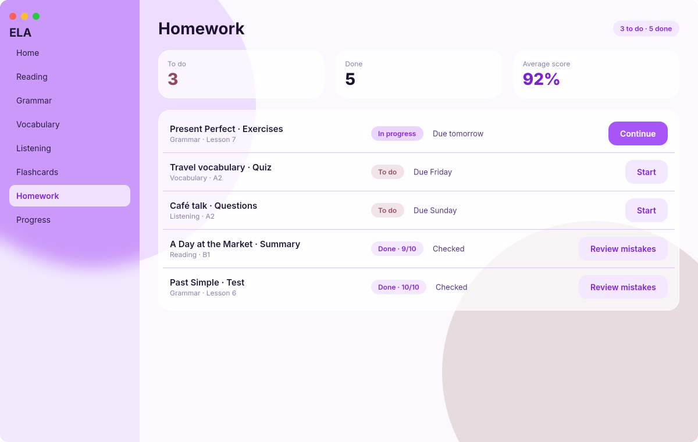 | 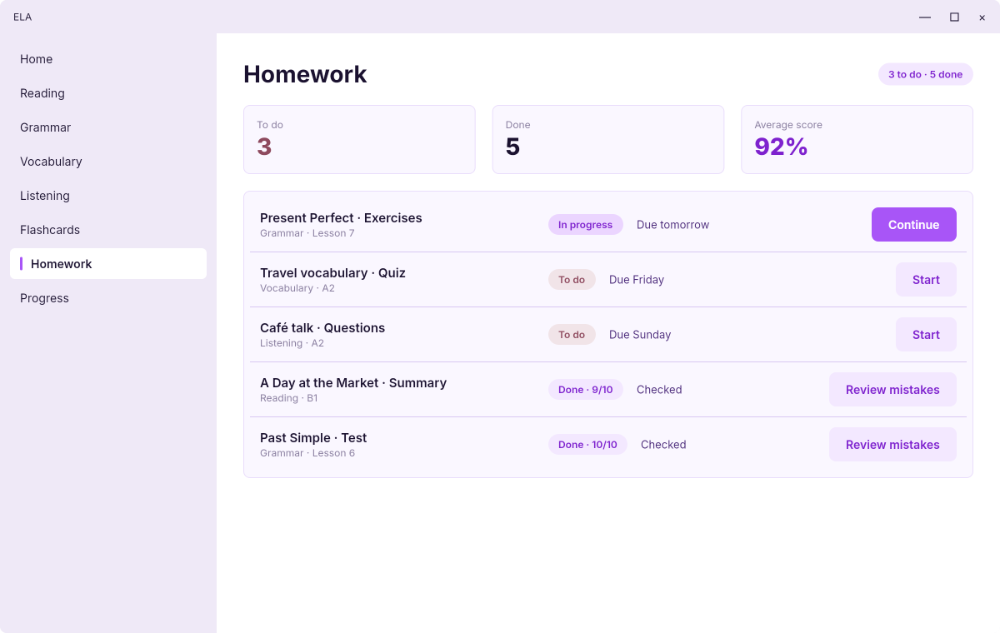 | 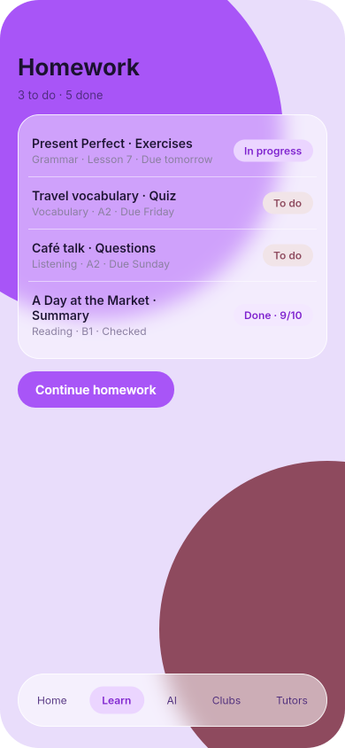 |

**Что видит и делает пользователь на этом экране:**

- **Сводка вверху:** три плитки — «To do» (сколько заданий осталось: 3), «Done» (выполнено: 5) и «Average score» (средний результат: 92%). Справа — краткая метка «3 to do · 5 done».
- **Список заданий.** Для каждого указаны название («Present Perfect · Exercises»), раздел и урок («Grammar · Lesson 7»), статус и срок сдачи («Due tomorrow», «Due Friday»).
- **Статусы:** «In progress» — начато, «To do» — ещё не начато, «Done · 9/10» — выполнено, с оценкой.
- **Кнопка действия зависит от статуса:** «Continue» — продолжить начатое (сохранённый черновик подтягивается); «Start» — начать; «Review mistakes» — разобрать ошибки в уже проверенном задании.

#### Читать тексты

- **Актор:** User.
- **Цель:** практиковать чтение и пополнять словарный запас в контексте.
- **Предусловия:** есть опубликованные тексты с указанием уровня и времени чтения (например, «B1 · 4 min»).
- **Основной сценарий:**
  1. Пользователь выбирает текст из списка.
  2. Система показывает текст на английском.
  3. Пользователь читает текст; при нажатии на незнакомое слово система показывает карточку слова: перевод, транскрипцию, часть речи.
  4. Пользователь завершает чтение, система отмечает текст как прочитанный.
- **Связанный прецедент:** «Добавлять слова из текстов и заданий в словарь».
- **Постусловие:** текст отмечен в истории, обновлена статистика занятий.

**Как это выглядит на экране** — Reading: текст и карточка слова (macOS, Windows, iOS):

| macOS | Windows | iOS |
|:---:|:---:|:---:|
| 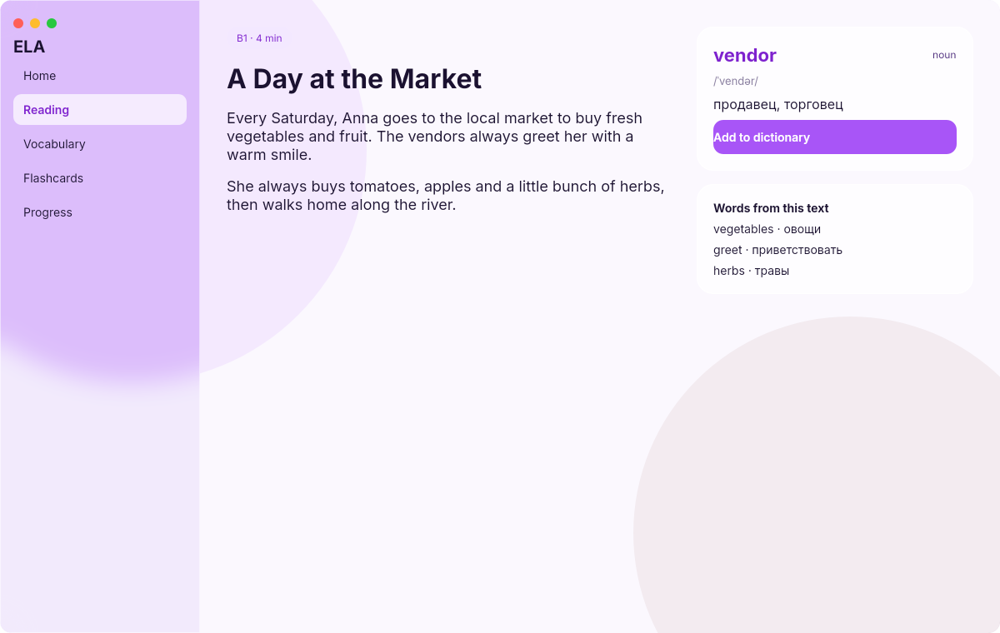 | 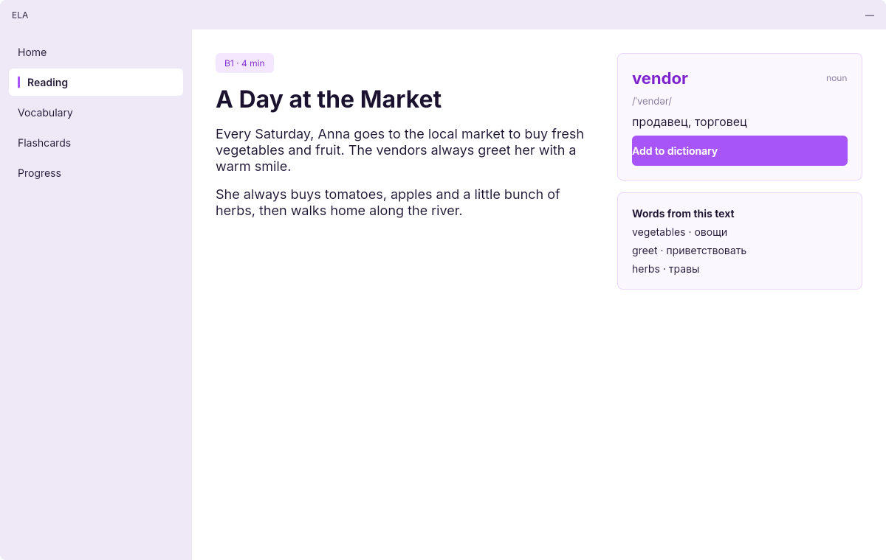 | 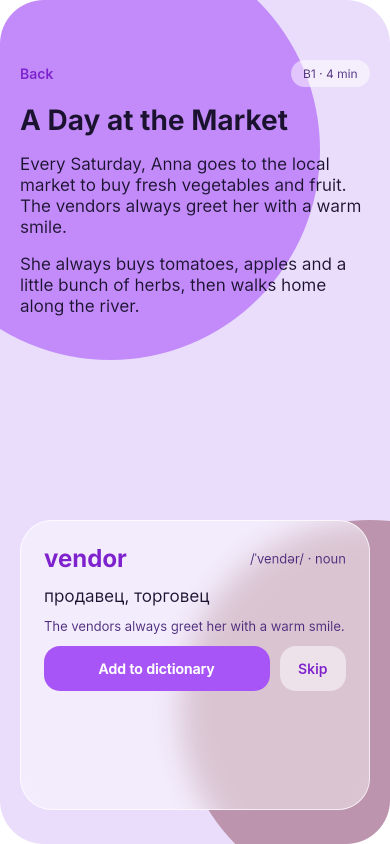 |

**Что видит и делает пользователь на этом экране:**

- **Текст слева.** Метка с уровнем и временем чтения («B1 · 4 min»), заголовок («A Day at the Market») и крупный, удобный для чтения текст.
- **Карточка слова справа** появляется при нажатии на слово в тексте: слово («vendor»), часть речи (noun), транскрипция и перевод («продавец, торговец»). Не нужно переходить в другой словарь — перевод под рукой.
- **Кнопка «Add to dictionary»** — сохранить слово в личный словарь.
- **Блок «Words from this text»** — ключевые слова текста с переводом (vegetables — овощи, greet — приветствовать, herbs — травы) для быстрого просмотра.

#### Повторять карточки (spaced repetition)

- **Актор:** User.
- **Цель:** запомнить слова надолго с помощью интервальных повторений.
- **Предусловия:** в личном словаре есть карточки, срок повторения которых наступил (например, 24 карточки).
- **Основной сценарий:**
  1. Пользователь открывает раздел Flashcards.
  2. Система показывает слово на лицевой стороне карточки.
  3. Пользователь вспоминает перевод и переворачивает карточку (Tap to flip).
  4. Пользователь оценивает ответ: Again, Good или Easy.
  5. Система рассчитывает дату следующего показа по выбранной оценке (например, Again — через 1 минуту, Good — через 2 дня, Easy — через 6 дней) и показывает следующую карточку.
- **Альтернативный сценарий:** если карточек для повторения нет, система сообщает, что на сегодня всё выполнено; пользователь может закрыть сессию досрочно (Close), прогресс сохраняется.
- **Постусловие:** у каждой оценённой карточки обновлены интервал и дата следующего повторения.

**Как это выглядит на экране** — Flashcards: карточка и оценка (macOS, Windows, iOS):

| macOS | Windows | iOS |
|:---:|:---:|:---:|
| 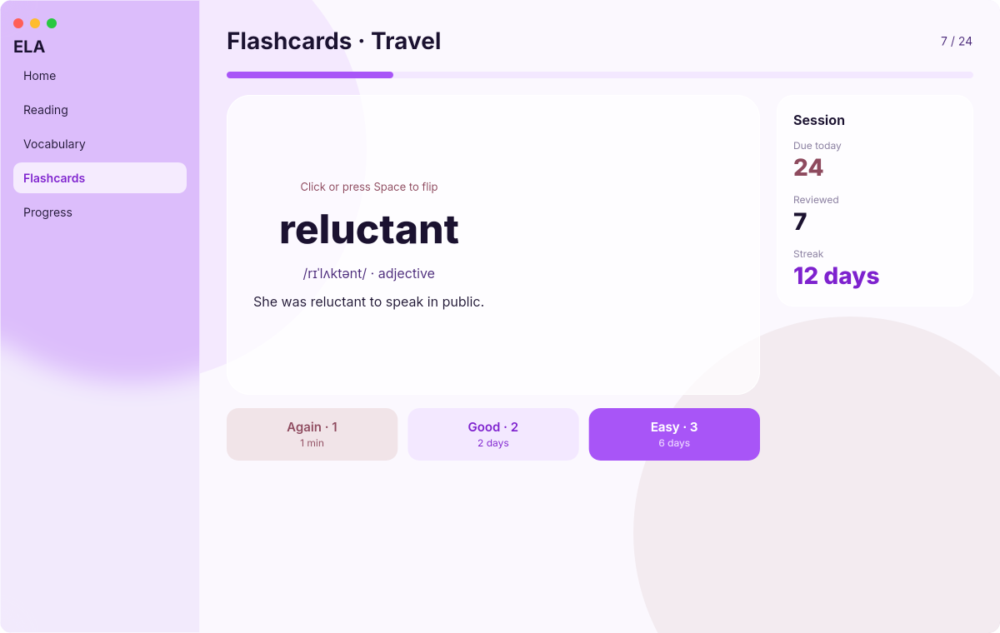 | 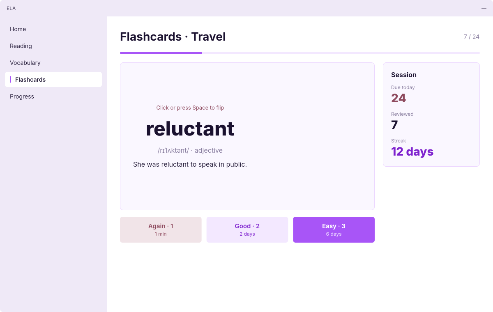 | 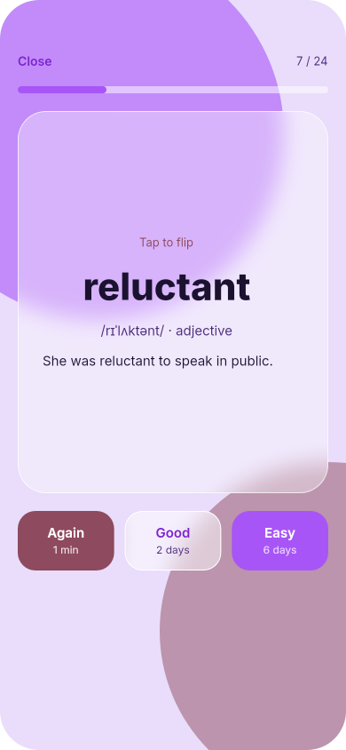 |

**Что видит и делает пользователь на этом экране:**

- **Заголовок и счётчик** («Flashcards · Travel», «7 / 24») с полосой прогресса: видно, сколько карточек пройдено в этой сессии.
- **Большая карточка** со словом («reluctant»), транскрипцией, частью речи и примером. Подсказка «Click or press Space to flip» — перевернуть карточку (на телефоне — касанием) и увидеть перевод.
- **Три кнопки оценки** с указанием, когда слово покажется снова: «Again · 1» (1 мин) — не вспомнил; «Good · 2» (2 дня) — вспомнил; «Easy · 3» (6 дней) — слишком легко. Пользователю не нужно планировать повторения — система делает это сама.
- **Панель «Session»:** «Due today» — сколько карточек надо повторить (24), «Reviewed» — уже повторено (7), «Streak» — серия дней занятий (12 days).

#### Видеть прогресс и achievements

- **Актор:** User.
- **Цель:** отслеживать свои успехи и сохранять мотивацию.
- **Предусловия:** пользователь имеет хотя бы одно завершённое занятие (для нового пользователя показываются нулевые значения).
- **Основной сценарий:**
  1. Пользователь открывает главный экран или раздел Progress.
  2. Система показывает серию дней занятий (streak), количество выученных слов, число карточек к повторению, прогресс по текущим урокам.
  3. Система показывает полученные achievements и ещё не открытые (серые бейджи со знаком «?»).
- **Дополнительно:** система автоматически выдаёт achievement, когда выполнено условие (например, 7 дней подряд или 100 выученных слов).
- **Постусловие:** состояние не меняется (прецедент только на просмотр).

**Как это выглядит на экране** — Главный экран: streak, слова, achievements (macOS, Windows, iOS):

| macOS | Windows | iOS |
|:---:|:---:|:---:|
| 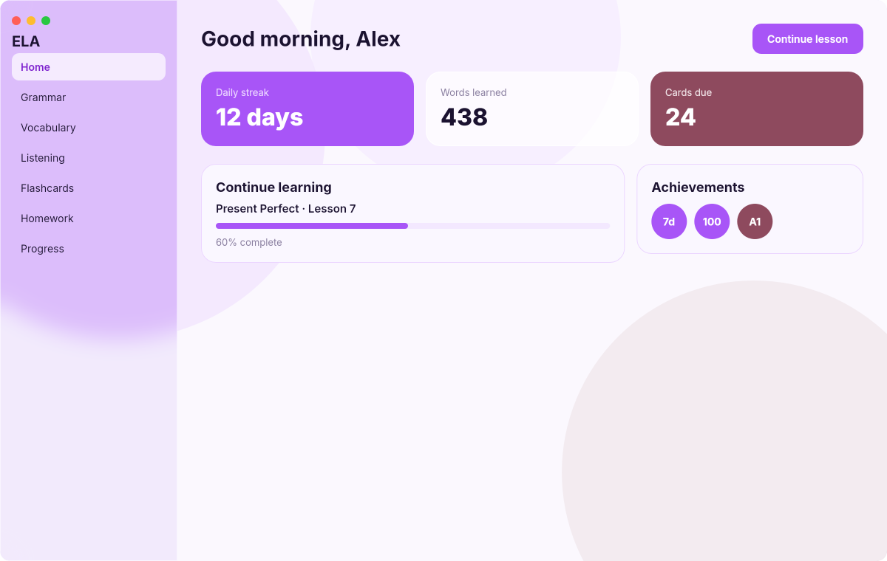 | 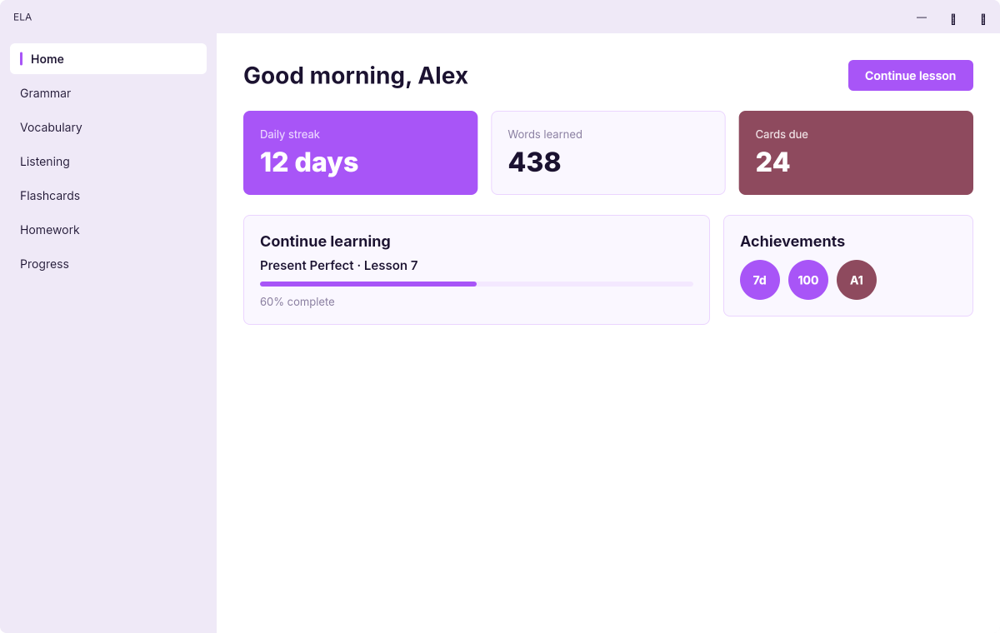 | 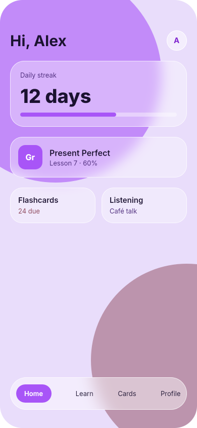 |

**Что видит и делает пользователь на этом экране:**

- **Приветствие** по имени («Good morning, Alex») и кнопка «Continue lesson» — быстро вернуться к последнему уроку.
- **Три цветные плитки:** «Daily streak» — сколько дней подряд пользователь занимается (12 days); «Words learned» — сколько слов выучено (438); «Cards due» — сколько карточек пора повторить (24).
- **Блок «Continue learning»:** текущий урок (Present Perfect · Lesson 7) и полоса «60% complete».
- **Блок «Achievements»:** круглые бейджи наград за достижения (например, 7 дней подряд, 100 слов, уровень A1). Ещё не полученные награды показаны серыми со знаком «?» — как цель на будущее.

#### Добавлять слова из текстов и заданий в словарь

- **Актор:** User.
- **Цель:** собрать личный словарь из незнакомых слов.
- **Предусловия:** пользователь находится в тексте или задании с интерактивными словами.
- **Основной сценарий:**
  1. Пользователь нажимает на слово.
  2. Система показывает карточку слова: перевод, транскрипцию, часть речи.
  3. Пользователь нажимает «+ Add to my dictionary».
  4. Система сохраняет слово в личный словарь и создаёт для него карточку для повторений.
- **Альтернативный сценарий:** слово уже есть в словаре, система сообщает об этом и не создаёт дубликат.
- **Постусловие:** слово добавлено в словарь и попадёт в очередь повторений (см. «Повторять карточки»).

**Как это выглядит на экране** — Reading: карточка слова с кнопкой «Add to dictionary» (macOS, Windows, iOS):

| macOS | Windows | iOS |
|:---:|:---:|:---:|
|  |  |  |

**Что видит и делает пользователь на этом экране:**

- **Нажатие на слово в тексте** открывает справа карточку: слово («vendor»), часть речи, транскрипция и перевод.
- **Кнопка «Add to dictionary»** — одно нажатие, и слово попадает в личный словарь. Для него автоматически создаётся карточка, которая потом появится в разделе Flashcards.
- **Блок «Words from this text»** показывает подборку ключевых слов текста.
- В разделе Vocabulary такая же кнопка «+ Add to my dictionary» есть на каждой карточке слова.

#### Модерировать контент (проверка и публикация)

- **Актор:** Content Moderator (Administrator наследует эту возможность).
- **Цель:** проверить качество материала перед публикацией.
- **Предусловия:** есть материалы (задания, темы, тексты) со статусом «На проверке».
- **Основной сценарий:**
  1. Модератор открывает очередь материалов на проверку.
  2. Модератор просматривает материал: ошибки, корректность перевода, уровень сложности.
  3. Модератор принимает решение: одобрить, отклонить или оставить комментарий с замечаниями.
  4. Система меняет статус материала и уведомляет автора.
- **Альтернативный сценарий:** при отклонении или замечаниях материал возвращается автору на доработку и после правок снова попадает в очередь.
- **Постусловие:** одобренный материал опубликован и доступен пользователям.

**Как это выглядит на экране** — Moderator: очередь проверки (macOS, Windows, iOS):

| macOS | Windows | iOS |
|:---:|:---:|:---:|
| 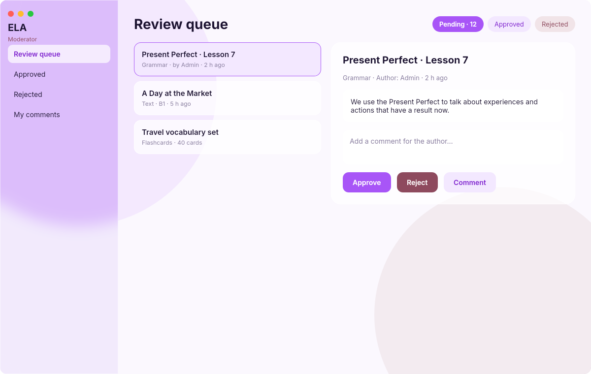 | 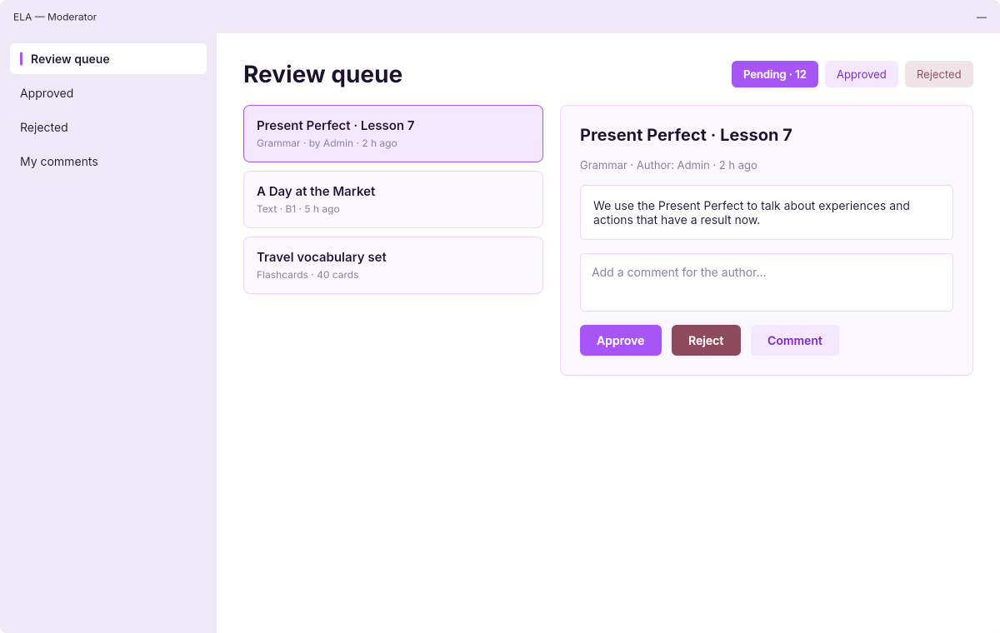 | 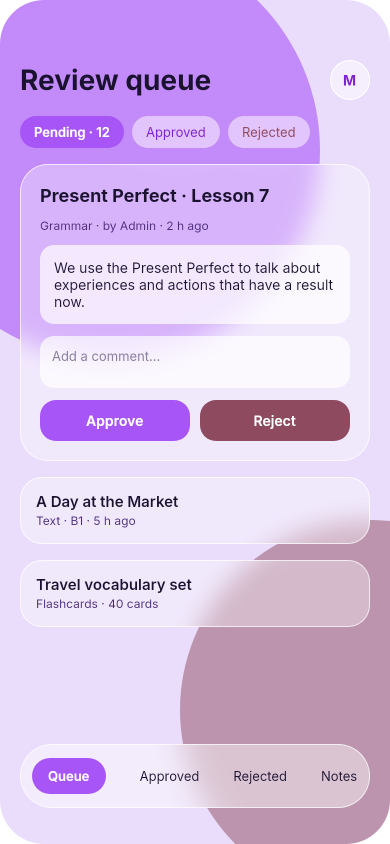 |

**Что видит и делает пользователь на этом экране:**

- **Меню модератора** (под названием ELA указана роль Moderator): «Review queue» — очередь, «Approved» — одобренное, «Rejected» — отклонённое, «My comments» — мои комментарии.
- **Фильтры вверху:** «Pending · 12» (ждут проверки), «Approved», «Rejected» — переключают список.
- **Список материалов слева.** Для каждого: название, тип (Grammar, Text, Flashcards), автор или уровень и время поступления («2 h ago»). Выбранный материал выделен рамкой.
- **Просмотр материала справа:** заголовок, автор, сам текст материала и поле «Add a comment for the author…» для замечаний.
- **Три кнопки решения:** «Approve» — одобрить и опубликовать; «Reject» — отклонить; «Comment» — отправить замечания автору без решения.

#### Управлять контентом (создание заданий, тем, текстов)

- **Актор:** Administrator.
- **Цель:** наполнять и поддерживать учебный контент платформы.
- **Предусловия:** у администратора есть доступ к панели управления.
- **Основной сценарий:**
  1. Администратор выбирает тип контента: задание, тема, текст, набор карточек, аудио.
  2. Администратор создаёт новый материал или редактирует существующий (заполняет содержимое, уровень, правильные ответы).
  3. Система проверяет обязательные поля.
  4. Администратор сохраняет материал, система отправляет его на проверку (см. «Модерировать контент»).
- **Альтернативный сценарий:** материал можно сохранить как черновик; устаревший материал можно архивировать, чтобы он не отображался пользователям.
- **Постусловие:** материал сохранён и ожидает модерации или опубликован.

**Как это выглядит на экране** — Admin: редактор контента (macOS, Windows, iOS):

| macOS | Windows | iOS |
|:---:|:---:|:---:|
| 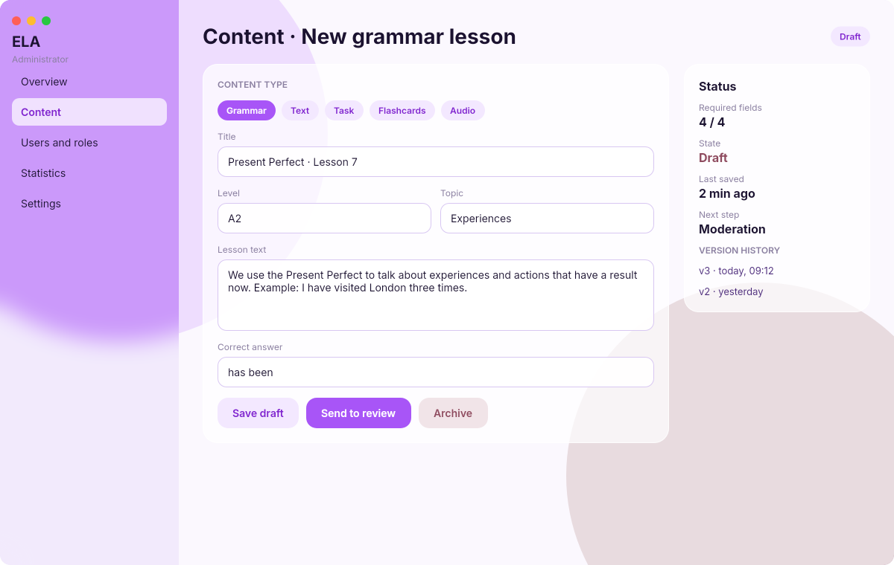 | 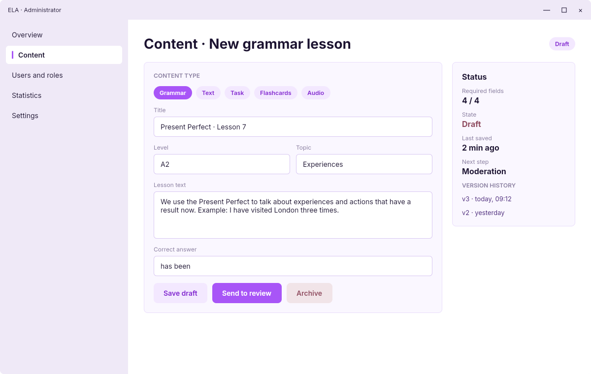 | 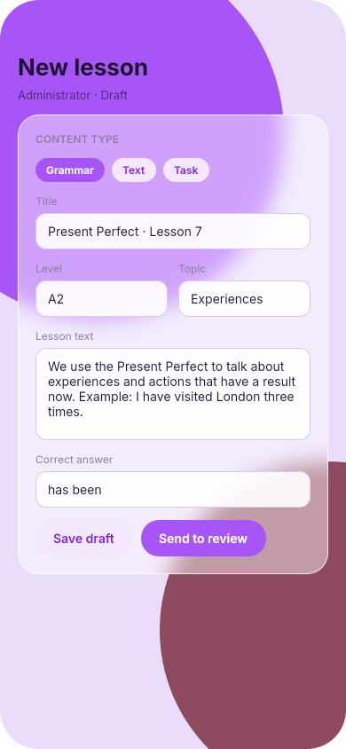 |

**Что видит и делает пользователь на этом экране:**

- **Меню администратора** (роль Administrator): Overview, Content, Users and roles, Statistics, Settings.
- **Заголовок** («Content · New grammar lesson») и метка статуса «Draft» (черновик).
- **Выбор типа контента:** переключатели Grammar, Text, Task, Flashcards, Audio.
- **Форма материала:** название (Title), уровень (Level, например A2), тема (Topic), текст урока (Lesson text) и правильный ответ (Correct answer).
- **Кнопки:** «Save draft» — сохранить черновик; «Send to review» — отправить на проверку модератору; «Archive» — убрать из показа пользователям.
- **Панель «Status» справа:** сколько обязательных полей заполнено (4 / 4), состояние (Draft), когда сохранено («2 min ago»), следующий шаг (Moderation) и история версий (v3, v2) — видно, как менялся материал.

#### Управлять пользователями и ролями

- **Актор:** Administrator.
- **Цель:** контролировать доступ к системе и распределять роли.
- **Предусловия:** у администратора есть доступ к панели управления.
- **Основной сценарий:**
  1. Администратор открывает список пользователей и находит нужного.
  2. Система показывает профиль: роль, дату регистрации, статус.
  3. Администратор изменяет роль (например, назначает пользователя модератором) или блокирует учётную запись.
  4. Система применяет изменения и записывает их в журнал действий.
- **Дополнительно:** администратор может просматривать агрегированную статистику по всем пользователям.
- **Постусловие:** права пользователя обновлены, они вступают в силу при следующем входе или обновлении сессии.

**Как это выглядит на экране** — Admin: пользователи и роли (macOS, Windows, iOS):

| macOS | Windows | iOS |
|:---:|:---:|:---:|
| 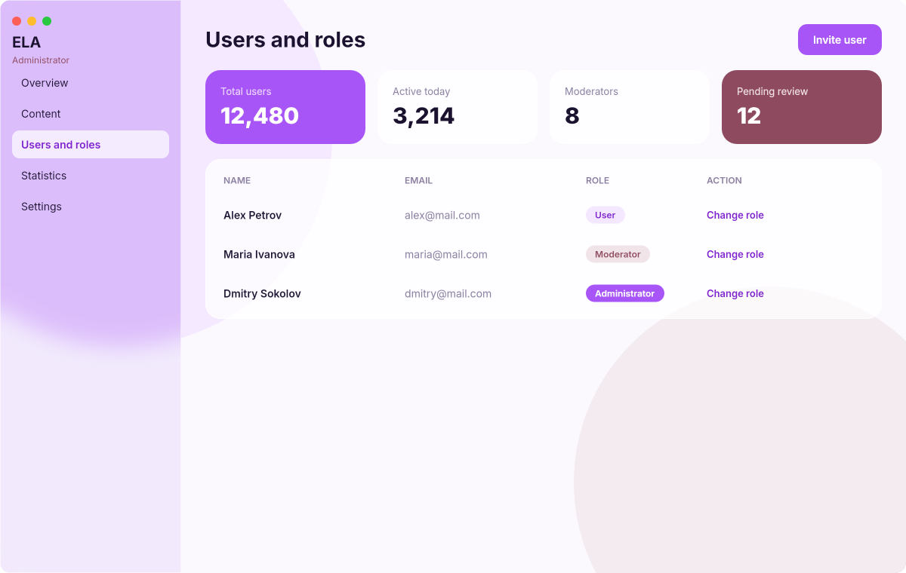 | 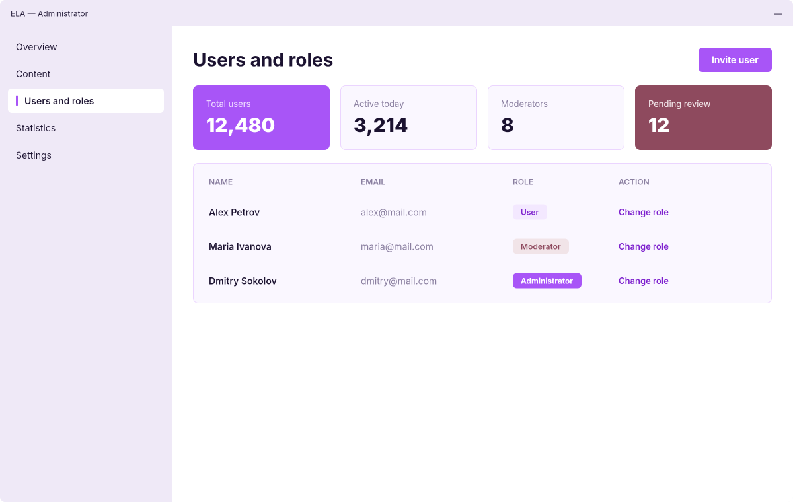 | 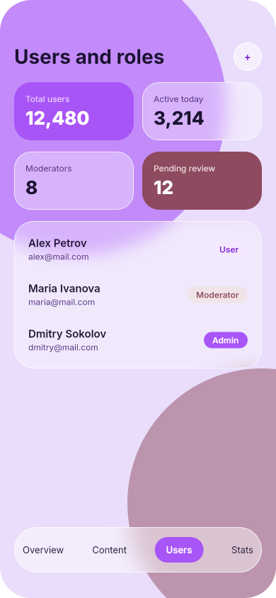 |

**Что видит и делает пользователь на этом экране:**

- **Сводка вверху:** «Total users» — всего пользователей (12,480), «Active today» — активны сегодня (3,214), «Moderators» — модераторов (8), «Pending review» — материалов на проверке (12).
- **Таблица пользователей:** имя (Name), почта (Email), роль (Role: User, Moderator или Administrator) и действие «Change role» — сменить роль в одно нажатие.
- **Кнопка «Invite user»** — пригласить нового пользователя.
- Раздел **Statistics** в меню даёт общую статистику по всем пользователям.

## 5. Описание интерфейса

### Общий стиль

Интерфейс светлый и спокойный. Основной цвет — фиолетовый, дополнительный акцентный — приглушённый бордовый. Фон светлый, с мягкими декоративными кругами. Карточки со скруглёнными углами и тонкой рамкой. Шрифт крупный и читаемый, заголовки жирные. Для всех платформ используются единые компоненты и цвета: основная кнопка — залитая фиолетовая («Continue lesson»), второстепенная — светло-сиреневая («Review words»).

**Общий макет интерфейса** (кнопки, мобильные экраны и главный экран на трёх платформах):

### Главный экран (Home)

Есть в трёх вариантах (macOS, Windows, мобильная версия):

### Мобильные экраны: главная, чтение текста, карточки

### Карта окон

